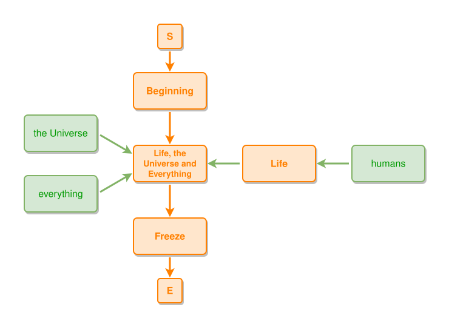

# Life, the Universe and Everything

The graph below is written as an SVG file next to this one, so it renders on
GitHub too.

```ipmt
Beginning
  --> "Life, the Universe and Everything" lue::a
  --> Freeze

Life --::P--> lue
the Universe ::t, everything ::t --> lue
humans ::t --> Life
```
<!-- ipm-svg id=100 hash=8b02d050 -->


Editing the fence re-renders the diagram in the preview immediately -- the SVG
on disk only catches up on save.
